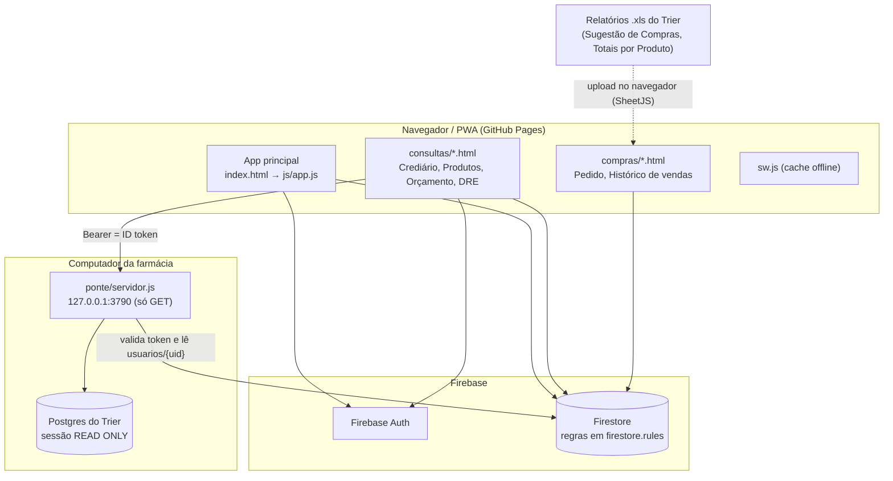
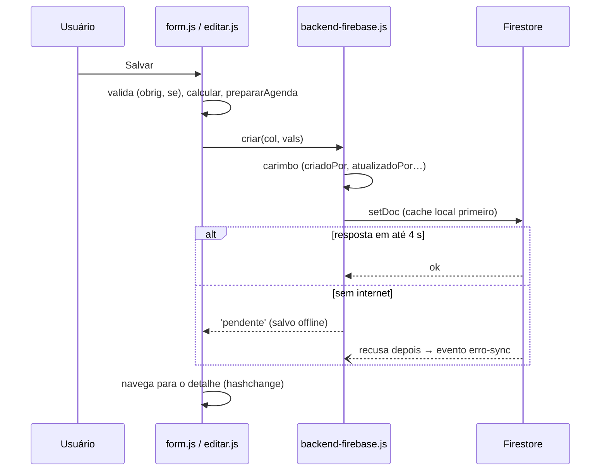

# Mapa do código: FarmaRotina

> Gerado pelo Cartographer. Último mapeamento: 14/11/2026.
> **Repositório público.** Este mapa não contém senhas, chaves nem dados de clientes ou de vendas.

## Visão geral

PWA em HTML, CSS e JavaScript puros (módulos ES, sem build), publicado no GitHub Pages. Login e dados ficam no **Firebase** (Auth + Firestore, plano gratuito). As telas que leem o sistema da farmácia (**Trier**, Postgres) passam por uma **ponte** Node local, somente leitura, que roda nos computadores da farmácia.



- **Modo demonstração:** se `firebaseConfig.projectId` estiver vazio em `js/config.js`, todo o app usa `js/backend-demo.js` (localStorage) e as consultas usam os arquivos `*-demo.js`, sem ponte.
- **Permissões:** `js/perm.js` decide o que aparece na tela; quem protege os dados de fato é o `firestore.rules`, mais a checagem de módulo na ponte.

## Estrutura de pastas

```
index.html, manifest.webmanifest, sw.js   PWA (shell, ícones, service worker)
css/styles.css                            todo o visual (tokens, claro/escuro, celular/desktop, impressão)
firestore.rules                           segurança do Firestore (publicar à mão no console)
js/
  config.js        Firebase, NOME_APP, NOME_FARMACIA, DEMO, PONTE_URL
  db.js            escolhe backend-firebase.js ou backend-demo.js
  backend-*.js     mesma interface (auth, usuários, registros, anexos)
  app.js           boot, shell (menu/barra), roteador por hash, busca no menu
  perm.js          MODULOS, PERFIS, ehAdmin/podeVer/podeEditar/podeExcluir
  form.js          formulário gerado a partir do schema
  agenda.js        agenda de aplicações, cores de prazo, WhatsApp, botão Registrar
  anexos.js        anexos comprimidos dentro do Firestore
  export.js        CSV e impressão
  preferencias.js  preferências por usuário (menu, atalhos) + arrastar e soltar
  notificacoes.js  avisos de lembrete no aparelho (só com o app aberto)
  subsite.js       login/permissão das páginas separadas (consultas/, compras/, loja/)
  loja.js          pedidos da loja online (Supabase do site): login da loja, fila, status, aviso de pedido novo
  util.js          helpers ($, esc, html, datas, moeda, toast, diálogo)
  modulos/         um "schema" por módulo (campos, alertas, ações)
  paginas/         telas genéricas (início, lista, detalhe, editar, caderno, busca…)
consultas/         páginas que leem o Trier pela ponte (+ dados demo)
compras/           Pedido de compras e Histórico de vendas (relatórios do Trier → Firestore)
loja/              Pedidos da loja online (lidos do Supabase do site, não do Firestore)
ponte/             servidor Node local para o Postgres do Trier (só leitura)
docs/              este mapa
```

## Guia dos módulos

### Boot e roteamento ([js/app.js](../js/app.js))

1. `index.html` carrega `js/app.js` e registra `sw.js` (fora de `file:`).
2. `db.observarAuth`:
   - **sem usuário:** limpa o hash e mostra `paginaLogin`;
   - **com usuário:** `obterPerfil`. Se não existir, espera 1,5 s e tenta de novo (cobre a corrida logo após "Criar conta"); se ainda faltar, `criarPerfilPendente`. `!ativo` → `paginaPendente` ("Aguardando aprovação" ou "Acesso removido"). Caso contrário: `definirPerfil`, `montarShell()`, `iniciarLembretes()`, `rotear()`.
3. Eventos globais: `hashchange` → `rotear`; `preferencias` → `atualizarMenu`; `erro-sync` → toast de gravação offline recusada.

| Hash | Tela |
|---|---|
| `#/` | `paginaInicio` |
| `#/m/<id>` | `paginaLista`, ou `paginaCaderno` se `schema.caderno` |
| `#/m/<id>/novo?…` | `paginaEditar` (o query string pré-preenche campos) |
| `#/m/<id>/<docId>` | `paginaDetalhe` (ou caderno) |
| `#/m/<id>/<docId>/editar` | `paginaEditar`, se `podeEditar` |
| `#/busca?q=` | `paginaBusca` |
| `#/configuracoes` | `paginaConfiguracoes` |
| `#/usuarios` | `paginaUsuarios` (só admin) |

As páginas `consultas/*.html` e `compras/*.html` não são rotas: são arquivos separados, abertos pelo menu, que usam `iniciarSubsite` e o mesmo login (mesma origem).

**Truque de redesenho:** depois de gravar, o código dispara `window.dispatchEvent(new HashChangeEvent('hashchange'))` para o roteador redesenhar a tela.

### Backend ([js/db.js](../js/db.js), [js/backend-firebase.js](../js/backend-firebase.js), [js/backend-demo.js](../js/backend-demo.js))

| Grupo | Funções |
|---|---|
| Auth | `observarAuth`, `entrar`, `sair`, `cadastrar`, `recuperarSenha`, `tokenAcesso` (ID token para a ponte), `definirUsuario` (quem assina as gravações) |
| Usuários | `criarPerfilPendente`, `obterPerfil`, `listarUsuarios`, `salvarUsuario` (update parcial; também grava `preferencias`) |
| Registros | `listar(col, {ordem, desc, de, ate, onde, limite})`, `obter`, `criar` → `{id, status}`, `atualizar` → `{status}`, `definir` (id escolhido), `apagar` (delete simples), `excluir` (apaga anexos e depois o documento) |
| Anexos | `listarAnexos`, `criarAnexo` (+1 em `nAnexos`), `atualizarAnexo`, `excluirAnexo` (−1) |
| Só demo | `reiniciarDemo`, `USUARIOS_DEMO` |

- **`listar`:** com `onde` faz igualdade sem `orderBy` e ordena no navegador (evita índice composto; o `limite` é aplicado antes da ordenação). Com `de`/`ate`, faz intervalo no campo `ordem`. Documentos sem o campo `ordem` ficam de fora.
- **Offline:** cache persistente do Firestore. `criar`, `atualizar`, `definir` e os anexos passam por `comPrazo`, que devolve `'pendente'` depois de 4 s ("Salvo offline…"); se o servidor recusar depois, dispara `erro-sync`. **Exclusões não funcionam offline.**
- **Auditoria (`carimbo`):** `criadoEm/Por/PorNome/Local` e `atualizadoEm/Por/PorNome/Local`. A tela mostra o `*Local` (relógio do aparelho). As regras exigem `atualizadoPor == uid`.
- **Demo:** chave `farmarotina-demo-v10` no localStorage (troque o número quando mudar os dados de exemplo); sessão em `sessionStorage`; o uid do usuário demo é o e-mail.

### Schemas dos módulos ([js/modulos/](../js/modulos/))

`index.js` exporta `SCHEMAS` (a ordem padrão do menu), `schemaPorId` e `visiveis()`.

| Schema (coleção) | Módulo de permissão | Arquivo | Destaques |
|---|---|---|---|
| `afericoes` | saude | saude.js | pressão/glicemia/oximetria, alertas, painel de clientes, histórico (folha + WhatsApp) |
| `injetaveis` | saude | saude.js | `agenda`, `calcularProxima`, declaração de aplicação |
| `temperatura` | temperatura | temperatura.js | geladeira + ambiente por turno, `porMes` (folha mensal), `normalizarTemp` para registros antigos |
| `atendimentos` | atendimento | cadastros.js | retorno, solução |
| `trocas`, `parceiros` | trocas | trocas.js | botões coloridos por tipo, `acaoRapida` Concluir; `parceiros` fica fora do menu |
| `clientes` | clientes | cadastros.js | consentimento LGPD obrigatório |
| `notas`, `controle` | notas | cadastros.js | `caderno` (tela em dois painéis), lembrete, `acaoRapida` Resolvido |
| `fornecedores` | fornecedores | cadastros.js | horário limite do pedido |
| `pops` | pops | cadastros.js | `somenteAdmin` |
| `rotinas` | rotinas | rotinas.js | repetição (`ocorrencia`), `acaoRapida` Feito, histórico |

**Opções do schema (quem lê cada uma):**

| Opção | Para quê | Lido em |
|---|---|---|
| `id`, `modulo`, `nome`, `novo`, `icone`, `ordem`, `desc` | identidade, permissão, ordenação | todo lugar |
| `campos[]` | ver tabela abaixo | form.js, detalhe.js, export.js, busca.js |
| `titulo/sub/valor(d)` | texto da linha | lista.js, busca.js, detalhe.js |
| `etiqueta(d)` → `{texto, cor}` | etiqueta colorida na linha | lista.js |
| `alerta(v)` → `{nivel, msg}` | selo, filtro "Só alertas", banner, prévia no formulário, métricas do início | lista.js, detalhe.js, form.js, inicio.js |
| `calcular(v)` | campos automáticos até o usuário editar (precisa aceitar `{}`) | form.js |
| `agenda` | seção "Agendadas" e bloco no detalhe | lista.js, detalhe.js, editar.js, agenda.js |
| `acaoRapida {rot, icone, msg, quando(d), dados(d)}` | botão de ação direto | lista.js (handler global) |
| `novos`, `links`, `voltar`, `menu:false` | botões e navegação | lista.js, preferencias.js |
| `somenteAdmin` | só admin edita | perm.js |
| `caderno`, `etiquetaAgenda` | anotações em dois painéis; rótulo na Agenda | app.js, caderno.js, inicio.js |
| `porMes`, `renderLista`, `impressaoMes` | lista própria por mês | lista.js |
| `normalizar(d)` | converte registros antigos | lista.js, detalhe.js, editar.js, busca.js |
| `painel {…, ligar, usaPeriodo, abaixoDoTitulo}` | painel extra acima da lista | lista.js |
| `historico`, `impressaoRegistro`, `detalheExtra` | impressões, WhatsApp, blocos extras | painel-clientes.js, detalhe.js |
| `aposCriar(vals, id)` → `{msg, hash}` | ação depois de criar | editar.js (**nenhum schema usa hoje**) |

**Campos:** `k`, `rot`, `rotLongo`, `ajuda`, `obrig`, `lg` (`'t'` = um terço, `'m'` = metade), `padrao`, `se(v)` (campo escondido é gravado como `null` e não é validado), `linhas`, `unidade`, `lista`, `semPadrao`. Tipos: `texto`, `tel`, `email`, `textarea`, `num`, `moeda`, `data`, `datahora`, `hora`, `simnao`, `multi`, `opcoes` (≤4 vira botões, senão lista), `ref` (`col`, `livre`, `preencher`; grava `xId` e `xNome`), `secao` (só título).

### Telas genéricas ([js/paginas/](../js/paginas/))

| Arquivo | O que faz |
|---|---|
| `inicio.js` | Avisos, métricas (escondíveis), atalhos, **Agenda** (aplicações, lembretes, retornos, rotinas; próximos 7 dias e atrasados), últimos registros |
| `lista.js` | Lista genérica: filtros, busca, CSV, impressão, agendadas, painel. Registra os **handlers globais** de `data-acao-rapida` e `tr[data-href]` |
| `detalhe.js` | Campos, auditoria, anexos, bloco de agenda, histórico do cliente/parceiro, `detalheExtra` |
| `editar.js` | Formulário de criar/editar; `dataHora` vazio vira agora; agenda; `aposCriar` |
| `caderno.js` | Anotações em dois painéis (lista + editor), ordenação salva no aparelho, Resolvido/Reabrir |
| `busca.js` | "Buscar em tudo": índice no navegador (300 mais novos por módulo, cache de 2 min), casamento por início de palavra |
| `painel-clientes.js` | Painel "Clientes" em Aferições e Injetáveis: histórico por período, impressão e WhatsApp |
| `configuracoes.js` | Preferências do usuário e notificações do aparelho |
| `usuarios.js` | Aprovar, dar módulos, editar, excluir (exclusão "suave": `excluido:true`) e restaurar |
| `login.js` | Login/cadastro; telas de pendente e de acesso removido |

### Preferências por usuário ([js/preferencias.js](../js/preferencias.js))

Ficam em `usuarios/{uid}.preferencias` e acompanham a pessoa em qualquer aparelho: `menuOrdem`, `menuOcultos`, `barraCelular` (até 3), `atalhosInicio`, `ocultarMetricas`. `salvarPreferencias(null)` restaura o padrão. As regras deixam o usuário ativo mudar **só** esse campo do próprio perfil. Notificações e a ordenação do caderno são por aparelho (localStorage).

### Consultas ao Trier ([consultas/](../consultas/))

`consultas/js/comum.js` define `CONSULTAS`, `api(caminho, demo)` (no modo demo usa os `*-demo.js`; senão faz `fetch(PONTE_URL + caminho)` com o ID token), `PonteDesligada` e `telaErro`.

| Página | Módulo | Rotas da ponte | Grava no Firestore |
|---|---|---|---|
| `crediario.html` | crediario | `/clientes`, `/clientes/:id`, `/clientes/:id/cadastro`, `/recebimentos`, `/atrasados` | nada |
| `produtos.html` | produtos | `/produtos`, `/produtos/:id`, `/produtos/:id/info` | nada |
| `orcamento.html` | orcamento | `/orcamento/produtos` (sem custo/margem) | `orcamentos` (com nome e telefone do cliente) |
| `dre.html` | dre (só admin) | `/dre?de=&ate=` (máx. 12 meses) | `dre_regras`, `dre_ajustes` |

- **Crediário:** busca de cliente (com total + juros), detalhe com parcelas marcáveis, saldos devedores, últimos pagamentos e cobrança por WhatsApp; recebimentos por caixa; clientes em atraso com total com juros.
- **Produtos:** preço, desconto, custo de aquisição, margem, estoque; tabela "Mesmo DCB"; compras e vendas do período.
- **Orçamento:** crediário = preço com o desconto padrão do Trier; à vista = desconto extra por item ou geral; aviso de desconto máximo; WhatsApp, impressão, duplicar, atualizar preços.
- **DRE:** resultado por competência + fluxo de caixa; classificação das despesas por fornecedor/descrição (`dre_regras`); lançamentos manuais (`dre_ajustes`, só no resultado); painel com gráficos (Chart.js) e visão anual.

### Compras ([compras/](../compras/))

| Página | Módulo | Dados |
|---|---|---|
| `pedido.html` | pedido | Lê o relatório "Sugestão de Compras" (.xls/.xlsx) no navegador; regras em `pedido_config`, `pedido_regras/{ean}`, `pedido_regras_marca/{marca}`; revisão em andamento no localStorage; exporta `EAN;quantidade` |
| `historico.html` | historico | Importa "Totais por Produto" mês a mês para `vendas_mensais/{AAAA-MM}` (campos curtos `c, d, l, g, q, cu, vb, vd, vl`); painel com filtros e gráficos |

**`motor-pedido.js`** (portado do sistema Python antigo):
- **Curva:** fora de A/B/C, não compra.
- **Encartelado** (`fat ≥ fator_encartelado`, padrão 20): compra 1 caixa se `saldo ≤ mínimo`.
- **Normal:** `alvo = max(mínimo da curva, sugestão do sistema)` e compra `ceil((alvo − saldo)/fat) × fat`.
- **Precedência:** sugestão < regra da marca (excluir) < regra do EAN (excluir > quantidade fixa > incluir sempre).

### Ponte ([ponte/](../ponte/))

- **`servidor.js`** (versão no `VERSAO`): escuta só em `127.0.0.1:3790`, aceita só GET.
  - Valida o **ID token do Firebase** (RS256, certificados do Google em cache, `aud`/`iss`/`exp`).
  - Lê `usuarios/{uid}` no Firestore com o token do próprio usuário. O resultado fica **5 minutos em cache**, então uma mudança de permissão leva até 5 minutos para valer na ponte.
  - **CORS:** aceita as `origens` do config, mais `localhost`/`127.0.0.1`, e envia `Access-Control-Allow-Private-Network`.
- **Rotas e módulo exigido:**
  - `/saude`: livre.
  - `/clientes…`, `/recebimentos` e `/atrasados`: crediario.
  - `/produtos…`: produtos.
  - `/orcamento/produtos`: orcamento.
  - `/dre`: dre.
- **`banco.js`:** lê o config em `C:\FarmaRotinaPonte\config.json` (fora do repo; chaves `host`, `porta`, `banco`, `usuario`, `senha`; opcionais `portaPonte`, `projetoFirebase`, `origens`, `rede` (1), `filial` (3), `carenciaJuros` (10)).
  - Pool `max 4`, sessão `READ ONLY` e `statement_timeout 15s`.
  - `date` vira string; `numeric`/`bigint` viram `Number`.
- **`explorar.js`:** CLI para descobrir a estrutura do banco sem imprimir dados (`npm run explorar`).
- **Ciclo de vida:**
  - **Iniciar:** `iniciar.bat`, com janela, ou `iniciar-oculto.vbs`, sem janela e com log em `ponte.log`.
  - **Reinício:** o laço do bat reinicia a ponte 10 s depois que ela cai.
  - **Parar:** `parar.bat` cria `parar.flag` e encerra o processo da porta 3790.

**Dicionário do Trier** (o que foi descoberto; detalhes nos comentários de `ponte/consultas.js`):

| Tabela | Significado |
|---|---|
| `cadcredi` | parcelas do crediário. Aberta = `dat_receb IS NULL`; `dat_cancreceb` = cancelado; `num_seqrec` agrupa um recebimento; `num_caixa` = caixa do dia |
| `cadslddv` | saldo devedor (sobra de pagamento parcial; `num_seqrecorig` = recebimento de origem) |
| `cadclien` | cliente: `prc_juros` (% ao dia, simples), `prc_multa`, limite, bloqueio, observações |
| `cadabcai` | abertura e fechamento de caixa |
| `cadprodu` | produto: `cod_reduzido`, `vlr_pmc`, `vlr_venda`, `prc_desconto`, `prc_descmax`, `vlr_custo` (custo de cadastro, **não** usar para margem) |
| `cadestoq` | estoque por filial, mínimo, demanda, curva, **`vlr_custoaq` (custo real)** |
| `cadcdbar` | códigos de barras |
| `cadicomp` + `cadforne` | compras (notas de entrada) |
| `cadivend` + `cadcvend` | itens vendidos e cabeçalho da venda (`tip_venda` V = venda, D = devolução) |
| `cadconpg` + `cadtdesp` | contas a pagar (`flg_tipo` D = despesa, F = fornecedor de mercadoria) |
| `financeiro_movimentacao` / `financeiro_categoria` | entradas de caixa |

Fórmulas principais:
- **Preço de venda:** `venda = vlr_venda × (1 − prc_desconto/100)`.
- **PMC:** `pmc = max(vlr_pmc, vlr_venda)`.
- **Custo:** `custo = vlr_custoaq` (ou `vlr_custo` se o primeiro estiver vazio).
- **Juros estimados:** só depois da carência (padrão 10 dias), `valor × prc_juros/100 × dias`, mais a multa. A mesma conta existe em JS (`encargos`) e em SQL (`comJurosSql`).

## Fluxos de dados

**Gravar um registro**



**Consulta ao Trier**

```mermaid
sequenceDiagram
    participant P as consultas/*.js
    participant A as Firebase Auth
    participant Po as Ponte (127.0.0.1:3790)
    participant FS as Firestore REST
    participant T as Postgres do Trier
    P->>A: tokenAcesso()
    P->>Po: GET /rota (Authorization: Bearer)
    Po->>Po: verifica assinatura RS256 + aud/iss/exp
    Po->>FS: usuarios/{uid} (com o token do usuário; cache 5 min)
    Po->>Po: ativo e (admin ou módulo da rota)?
    Po->>T: SELECT (sessão READ ONLY, timeout 15 s)
    T-->>Po: linhas
    Po-->>P: JSON
```

## Convenções

- Código, nomes e textos em **português**; identificadores sem acento (`clienteNome`, `dataHora`).
- **Datas** são strings locais `AAAA-MM-DDTHH:mm`, comparadas como texto. Não há fuso. Uma data sem hora vale 08:00 nos lembretes.
- Toda interpolação em HTML passa por `esc()`; elementos são criados com `html()`.
- Nomes relacionados são **desnormalizados** (`clienteNome`, `parceiroNome`): renomear um cliente não muda os registros antigos.
- Botões de ação usam atributos `data-*` com **handlers globais** registrados no import (`lista.js`, `agenda.js`, `consultas/js/comum.js`).
- CSS: tokens em `:root` com versão escura automática; classes `lg-t`/`lg-m` são **larguras** (terço/metade); `.so-celular`/`.some-celular`/`.so-desktop` por largura (corte em 860 px).
- Impressão: acrescenta `.area-impressao` ao `body` com a classe `imprimindo` (`export.js`).

### Pedidos da loja online ([loja/](../loja/), [js/loja.js](../js/loja.js))

- Os pedidos do site da farmácia ficam no **Supabase da loja** (repositório `farmacia`, pasta `site/`), não no Firestore. `js/loja.js` carrega o supabase-js por CDN só quando precisa e usa `LOJA_URL` e `LOJA_CHAVE` (chave pública) do `js/config.js`.
- **Dois logins:** o do FarmaRotina (Firebase) decide quem vê o módulo `loja`; o da loja (Supabase, conta na tabela `admins`) é feito uma vez por aparelho e fica no localStorage (`farmarotina-loja`). Quem protege os pedidos é o RLS do banco da loja.
- `loja/pedidos.html` tem as rotas `#/` (fila) e `#/p/<id>` (pedido); muda a situação pela função `admin_mudar_status` do banco. `proximosStatus` espelha as transições dessa função.
- **Tela inicial:** `pedidosParaInicio()` devolve os pedidos em aberto, que viram cartões na Agenda (`montarAgenda` em `js/paginas/inicio.js`), o aviso de pedidos novos e a métrica. Nada é gravado no Firestore. O clique no cartão (`data-pedido-loja`) abre a janela do pedido de `js/loja-pedido.js`, que carrega o `loja/loja.css` na hora.
- **Aviso de pedido novo:** `iniciarVigiaPedidos()` (chamado em `js/app.js`) consulta a loja a cada minuto e compara com o maior número já avisado (`farmarotina-loja-ultimo`).
- No modo demonstração há pedidos de exemplo guardados no localStorage (`farmarotina-loja-demo`).

## Pegadinhas

- **Pedidos da loja dependem do login da loja no aparelho:** sem ele, a tela inicial mostra o aviso para conectar e a Agenda não lista pedidos. Mudanças no banco da loja (colunas de `pedidos`, `admin_mudar_status`, `admin_resumo_pedidos`) precisam ser refletidas em `js/loja.js`.

- **Regras do Firestore precisam ser publicadas à mão** no console sempre que `firestore.rules` mudar; até lá, as gravações novas dão erro de permissão, inclusive para o admin.
- **`modulo` ≠ `id`:** vários schemas dividem uma permissão (`afericoes`/`injetaveis` → `saude`; `notas`/`controle` → `notas`; `trocas`/`parceiros` → `trocas`), e `atendimentos` usa `atendimento`.
- **O módulo `dre` não está em `MODULOS`** (`js/perm.js`): na prática, o DRE é só para admin (a página e a ponte também bloqueiam).
- `agenda.js` e `lista.js` **precisam ser importados** para os botões Registrar e de ação rápida funcionarem (os handlers são globais).
- `saude.js` importa `painel-clientes.js` de forma dinâmica para evitar import circular.
- Exclusões não funcionam offline (não passam por `comPrazo`).
- A busca global só olha os **300 registros mais novos** de cada módulo e guarda o índice por 2 minutos.
- Anexos ficam como data-URL no próprio Firestore (limite de ~650 KB por arquivo, por causa do limite de 1 MiB por documento).
- A ponte guarda a permissão do usuário por **5 minutos**; o `parar.bat` usa a porta **3790 fixa** (não acompanha um `portaPonte` diferente).
- Ponte antiga é detectada pela tela: sem `comJuros` → anterior à 1.3; 404 em `/clientes/:id/cadastro` → anterior à 1.5.
- **Privacidade:** a consulta de vendas de um produto mostra o nome do cliente, e os orçamentos guardam nome e telefone no Firestore. Relatórios, `.db` e `.json` de vendas **nunca** entram no repositório (ele é público).
- Notificações de lembrete só funcionam com o app aberto (não há push) e ignoram lembretes com mais de 12 h.
- O `sw.js` usa o cache `farmarotina-v3`; troque o nome para forçar a limpeza do cache antigo.
- **Possível brecha nas regras:** um usuário excluído (`excluido:true`, `ativo:false`) poderia, pela regra de "perfil pendente", regravar o próprio perfil como pendente e assim apagar o `excluido`. O app nunca faz isso, mas daria para fechar exigindo que `excluido` continue igual.
- `aposCriar` ainda é lido por `editar.js`, mas nenhum schema o usa hoje.

## Guia de navegação

- **Novo módulo no app:**
  1. Schema em `js/modulos/<arquivo>.js`.
  2. Item em `SCHEMAS` (`js/modulos/index.js`).
  3. Módulo em `MODULOS`/`PERFIS` (`js/perm.js`).
  4. Bloco `match` no `firestore.rules`, e publicá-lo.
  5. Opcional: dados em `js/backend-demo.js`, trocando a chave `farmarotina-demo-vN`.
- **Novo campo:** uma linha em `campos` do schema (formulário, detalhe, CSV e busca se ajustam sozinhos).
- **Nova consulta ao Trier:**
  1. Função SQL em `ponte/consultas.js`.
  2. Rota e módulo em `ROTAS`/`NOMES` de `ponte/servidor.js`, subindo o `VERSAO`.
  3. Página `.html` + `.js` em `consultas/` usando `iniciar`/`api`.
  4. Item em `CONSULTAS` (`consultas/js/comum.js`).
  5. Módulo com `grupo:'consultas'` em `js/perm.js`.
  6. Dados demo em `consultas/js/*-demo.js`.
  7. Reiniciar a ponte nos computadores da farmácia.
- **Mudar permissões:** `js/perm.js` (tela) e `firestore.rules` (dados); para as consultas, também `ROTAS` em `ponte/servidor.js`.
- **Mudar a Agenda da tela inicial:** `montarAgenda` em `js/paginas/inicio.js`; cartões e WhatsApp em `js/agenda.js`.
- **Mudar textos de WhatsApp:** `js/agenda.js` (aplicações e retornos), `js/modulos/trocas.js` (`mensagemTroca`), `js/modulos/saude.js` (históricos), `consultas/js/crediario.js` (cobrança), `consultas/js/orcamento.js` (orçamento).
- **Preferências do usuário:** `js/preferencias.js` + `js/paginas/configuracoes.js`; menu e modo Organizar em `js/app.js`.
- **Visual:** `css/styles.css` (app) e `consultas/consultas.css` / `compras/compras.css` (páginas separadas).
